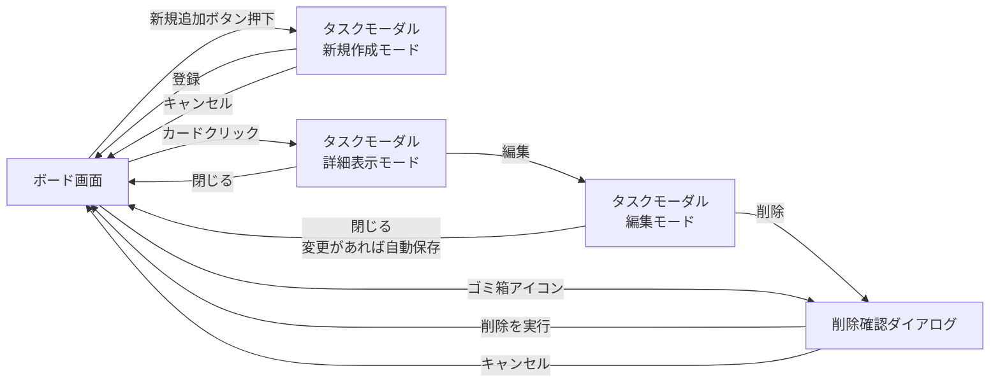

# タスク管理アプリ 画面設計書

本書は [要件定義書](./要件定義書.md) の「4. 画面仕様」を詳細化したものである。

---

## 1. 画面構成

本アプリは以下の2つの画面(状態)で構成する。

| 画面 | 概要 |
|---|---|
| ボード画面 | アプリ起動時に表示するメイン画面。フィルタバーと、「未着手」「作業中」「完了」の3列・タスクカードを表示する |
| タスクモーダル | タスクの新規作成・詳細表示・編集を行うダイアログ(ボード画面上にオーバーレイ表示)。新規作成モード・詳細表示モード・編集モードを持つ |

このほか、削除前に確認する「削除確認ダイアログ」を表示する。

---

## 2. ボード画面

- 画面上部にアプリタイトル(「タスク管理ボード」)を表示する
- タイトルの下に、フィルタバーを表示する
  - キーワード検索(テキスト入力。タイトル・説明文が対象。入力から300ミリ秒後に反映)
  - ステータスの絞り込み(すべての状態/未着手/作業中/完了)
  - 優先度の絞り込み(すべての優先度/高/中/低)
  - 全体の並び替え(デフォルト/優先度(高→低)/優先度(低→高)/期限(近い順)/期限(遠い順))
- 画面中央に3つの列(未着手/作業中/完了)を横に並べて表示する
- 各列には以下を表示する
  - 列名(見出し)
  - 列内の並び替えボタン(「重要度順」「期日順」。選択中は強調表示され、もう一度押すと解除される。表示のみに適用され、保存はされない)
  - 列内のタスクカード一覧(縦に並べる。0件の場合は「タスクがありません」)
  - タスクを新規追加するためのボタン(「+ タスクを追加」。「未着手」列のみに表示する)
- 各タスクカードには以下の情報を表示する
  - タイトル
  - 優先度(色分けしたバッジ)
  - 期限(設定されている場合。「期限: YYYY-MM-DD」。期限切れは赤、期限間近(今日から3日以内)は黄で太字に強調する)
  - 右上のゴミ箱アイコン(押すと削除確認ダイアログを表示する。ホバーまたはフォーカス時に表示される)
- カードをクリックするとタスクモーダルを詳細表示モードで開く
- カードはドラッグ&ドロップで列間移動・同列内並び替えができる。ドラッグ中は挿入位置を青い線で示す
  - 列の並び替えボタンの選択中、またはフィルタバーで全体の並び替えを指定している間は、表示順と保存順が異なるため同列内の位置指定はできない(別の列へ移動した場合は移動先の末尾に追加される)
- 読み込み中は「読み込み中...」、API呼び出しに失敗した場合はエラーメッセージを表示する

---

## 3. タスクモーダル

### 3.1 新規作成モード

以下の入力項目を持つ。

| 項目 | UI部品 | 備考 |
|---|---|---|
| タイトル | テキスト入力 | 必須(ラベルに `*` を表示)。255文字まで |
| 説明文 | 複数行テキストエリア | 任意項目 |
| 優先度 | セレクトボックス(高/中/低) | 必須(ラベルに `*` を表示)。デフォルトは「中」 |
| 期限 | 日付入力(`<input type="date">`) | 任意項目 |

- 「登録」ボタンで保存し、モーダルを閉じてボード画面に戻る。登録したタスクは「未着手」列の末尾に追加される
- 「キャンセル」ボタンで入力を破棄してモーダルを閉じる(背景クリック・Escキーでは閉じない)
- タイトルが未入力(空白のみを含む)の場合は「タイトルを入力してください」を表示し、登録しない
- 保存に失敗した場合は「登録に失敗しました: ○○」を表示する

### 3.2 詳細表示モード

- カードをクリックして開いた直後は、タイトル・説明文・優先度・期限・ステータスを閲覧専用で表示する(未設定の項目は「-」)
- 「編集」ボタンで編集モードに切り替える
- 「閉じる」ボタン、背景クリック、Escキーでモーダルを閉じる

### 3.3 編集モード

新規作成モードの4項目に加え、「ステータス」(セレクトボックス。未着手/作業中/完了)を持つ。別のステータスに変更して保存した場合は、移動先の列の末尾に配置される。

- 「更新」「キャンセル」ボタンは持たない。「閉じる」ボタン、背景クリック、Escキーでモーダルを閉じるときに、入力内容に変更があれば自動的に保存する(変更がなければ保存せず閉じる)。編集内容を破棄する手段は提供しない
- タイトルが空の状態で閉じようとした場合は「タイトルを入力してください」を表示し、閉じない
- 保存に失敗した場合は「更新に失敗しました: ○○」を表示し、閉じない
- 「削除」ボタンを表示する。押すと削除確認ダイアログ(「はい」「いいえ」)を表示する

### 3.4 削除確認ダイアログ

- ブラウザ標準の `confirm` ではなく、アプリ独自のカスタムダイアログ(ボード上にオーバーレイ表示。スクリーンリーダー向けに `role="alertdialog"` を指定)とする
- 削除対象を取り違えないよう、メッセージに削除対象のタスクのタイトルを表示する
  - 表示例: 「『○○○(タスクのタイトル)』を本当に削除してよろしいですか(この操作はもとに戻せません。)。」
  - タイトルは React の標準描画でエスケープして表示する。長いタイトルは折り返して全文を表示する
- カードのゴミ箱アイコンから開いた場合の選択肢は「OK」(削除を実行)/「キャンセル」。編集モードの「削除」ボタンから開いた場合は「はい」(削除を実行)/「いいえ」
- Escキーでキャンセルする。削除はDBからの物理削除で、元に戻せない
- 削除に失敗した場合はエラーメッセージ「削除に失敗しました: ○○」を表示する

---

## 4. 入力値のバリデーション

| 項目 | ルール |
|---|---|
| タイトル | 必須(空白のみは不可)。255文字以内(入力欄の `maxLength` とDBの `VARCHAR(255)` で制限) |
| 説明文 | 任意。文字数の上限は設けない(DBは `TEXT`) |
| 優先度 | 必須。高/中/低のいずれか |
| 期限 | 任意。過去の日付も登録できる |

エラーメッセージの文言はタイトル未入力時の「タイトルを入力してください」のみで、その他の失敗時はAPIが返したメッセージを表示する。

---

## 5. 画面遷移図

